# CtxDock

**Save what matters. Recall anywhere.**

CtxDock is a local-first Agent Skill for carrying curated project knowledge, architectural decisions, constraints, and session handoffs between coding-agent sessions. It uses 100% Python standard library (`sqlite3`, `json`, `pathlib`) with zero cloud dependencies, no network calls, and no embedding APIs.

---

# **RECOMMENDED INSTALLATION: COPY TO YOUR CODING AGENT**

Simply copy and paste this single instruction into your AI coding agent (Antigravity, Claude Code, Cursor, OpenAI Codex, or Gemini CLI):

```text
Install the CtxDock skill from https://github.com/TheLastAdmiraL/CtxDock
```

> **You can install it using `git clone` but the config requires questions that you will need to answer. We recommend using the instruction given to the agent. If you do `git clone` then you can set it up from your agent by giving these instructions:**
>
> 1. Clone the repository:
>    ```bash
>    git clone https://github.com/TheLastAdmiraL/CtxDock.git
>    cd CtxDock
>    ```
> 2. Open your coding agent in the directory and say:
>    ```text
>    Set up CtxDock from this repository
>    ```
> 3. Your agent will ask you two simple questions in chat:
>    * **Scope**: Do you want **Project-Specific** memory (`.ctxdock/` inside this repo) or **Global** memory (`~/.ctxdock/` across all projects)?
>    * **Agents**: Which agents should have access? (`Antigravity`, `Claude Code`, `Cursor`, `OpenAI Codex`, `Gemini CLI`, or `All`)
>
> Your agent will automatically configure the skill hooks with **zero pip dependencies**.

---

## Token Consumption Benchmark & Context Reduction

Re-pasting entire chat transcripts or re-reading multiple source files across sessions burns tens of thousands of tokens. CtxDock replaces transcript-dumping with **compact, progressive retrieval**.

### Visual Token Comparison per Workflow Turn

```mermaid
xychart-beta
    title "Context Token Consumption per Workflow Turn (Lower is Better)"
    x-axis ["Architecture Recall", "Bug Workaround", "Session Continuity", "Policy Constraints"]
    y-axis "Tokens Consumed" 0 --> 7000
    bar [3411, 2539, 6026, 2180]
    bar [845, 829, 700, 864]
```


*(Blue/Left bar: **Without CtxDock** | Green/Right bar: **With CtxDock**)*

### Measured Context Reduction Table

| Workflow Scenario | Without CtxDock *(Files / Logs Scanned)* | With CtxDock *(Progressive Retrieval)* | Tokens Saved | Context Reduction |
| :--- | :---: | :---: | :---: | :---: |
| **Session Continuity & Task Handoff** | 6,026 tokens *(3 files)* | **700 tokens** | **+5,326 tokens** | **-88.4%** |
| **Architecture Decision Recall** | 3,411 tokens *(5 files)* | **845 tokens** | **+2,566 tokens** | **-75.2%** |
| **Bug Workaround & Edge-Case Memory** | 2,539 tokens *(4 files)* | **829 tokens** | **+1,710 tokens** | **-67.3%** |
| **Library Policy & Technical Constraints** | 2,180 tokens *(4 files)* | **864 tokens** | **+1,316 tokens** | **-60.4%** |
| **Overall Benchmark Total** | **14,156 tokens** | **3,238 tokens** | **+10,918 tokens** | **-77.1%** |

---

### Detailed Breakdown: What CtxDock Does Behind the Scenes

CtxDock achieves these savings through a three-stage progressive retrieval architecture:

```text
┌─────────────────────────────────────────────────────────────────────────────────┐
│ Stage 1: Ultra-Lean Idle Footprint (~340–460 tokens)                            │
│ The skill definition loaded into the agent's system prompt is under 50 lines.   │
│ It consumes almost no context while idle and introduces zero token bloat.       │
└───────────────────────────────────────┬─────────────────────────────────────────┘
                                        │ (When agent needs past context)
                                        ▼
┌─────────────────────────────────────────────────────────────────────────────────┐
│ Stage 2: Fast Locator Search (~250 tokens)                                      │
│ Agent calls: python scripts/ctxdock.py find "<query>"                           │
│ Returns only 1-line locator tuples: id, title, category, status, and snippet.   │
│ Strips all full summaries, rationales, and revision logs.                       │
└───────────────────────────────────────┬─────────────────────────────────────────┘
                                        │ (If specific details are needed)
                                        ▼
┌─────────────────────────────────────────────────────────────────────────────────┐
│ Stage 3: Targeted Precision Detail (~100–150 tokens)                            │
│ Agent calls: python scripts/ctxdock.py get <id> --summary                       │
│ Returns strictly the single relevant decision and rationale.                    │
│ Total context added: ~350–400 tokens (vs. 5,000–25,000 tokens for whole files). │
└─────────────────────────────────────────────────────────────────────────────────┘
```

---

### How to Test Token Consumption Yourself

You can run the token benchmark directly from your terminal:

```bash
# Execute the automated benchmark
python benchmarks/run_token_benchmark.py
```

This runs all realistic multi-session scenarios, outputs the terminal report, and generates:
1. **Interactive HTML Dashboard**: [`benchmarks/results/token_usage.html`](benchmarks/results/token_usage.html) — open in any browser for interactive comparison bars and breakdown metrics.
2. **Raw JSON Metrics**: [`benchmarks/results/token_usage.json`](benchmarks/results/token_usage.json) — machine-readable token counts.

---

## Storage Architecture: Project-Specific vs. Global

CtxDock automatically detects where to store and read memories:

### 1. Project-Specific (Local) Mode
* **Location**: `<repo>/.ctxdock/`
* **Team Sharing**: JSON records in `.ctxdock/records/` can be committed to Git so anyone on your team (and their agents) shares the exact same architectural history.
* **Safe Defaults**: SQLite search indices (`*.db`, `*.db-wal`) are automatically `.gitignore`'d and safely rebuilt locally on demand with zero merge conflicts.
* **Boundary**: Memories never leave the repository.

### 2. Global Mode
* **Location**: `~/.ctxdock/` (or `%USERPROFILE%\.ctxdock` on Windows).
* **Cross-Project Access**: Accessible by all agents across any project on your computer.
* **Isolation**: Records remain project-isolated by default, with explicit `--scope shared` for global developer preferences and rules.

---

## Agent Integration Hooks

When installed, CtxDock integrates into each agent's native discovery workflow without requiring global environment modifications:

| Agent | Global Hook Location | Project-Specific Hook Location |
| :--- | :--- | :--- |
| **Antigravity** | `~/.agents/skills/ctxdock/` | `<repo>/.agent/skills/ctxdock/` |
| **OpenAI Codex** | `~/.agents/skills/ctxdock/` | `<repo>/.agents/skills/ctxdock/` |
| **Cursor** | `~/.cursor/rules/ctxdock.mdc` | `<repo>/.cursor/rules/ctxdock.mdc` |
| **Claude Code** | Global `~/.claude/` rule | Appends pointer to `<repo>/CLAUDE.md` |
| **Gemini CLI** | `~/.gemini/skills/ctxdock/` | `<repo>/.gemini/skills/ctxdock/` |

---

## First Use & Usage Examples

Agents run the bundled standard-library runner directly:

### 1. Search Historical Knowledge
```bash
python .agent/skills/ctxdock/scripts/ctxdock.py find "database architecture"
python .agent/skills/ctxdock/scripts/ctxdock.py get mem-0123456789abcdef --summary
```

### 2. Record a Finalized Decision
```bash
printf '%s' '{"title":"Database Engine","summary":"Use PostgreSQL 17 for multi-tenant data.","category":"architecture","rationale":"Strong relational isolation.","tags":["db","postgres"]}' | python .agent/skills/ctxdock/scripts/ctxdock.py save
```

### 3. Session Handoffs
```bash
# Record handoff at end of session:
printf '%s' '{"current_goal":"Ship auth MVP","completed_work":["tokens","schema"],"blockers":[],"next_actions":["verify tests"]}' | python .agent/skills/ctxdock/scripts/ctxdock.py handoff

# Retrieve handoff at start of next session:
python .agent/skills/ctxdock/scripts/ctxdock.py handoff
```

---

## Security, Boundaries & Storage Reliability

- **Secret Detection**: Rejects commits containing private keys, AWS tokens, GitHub credentials, JWTs, API keys, or raw password assignments while permitting standard placeholders (`<redacted>`, `[removed]`, `${PASSWORD}`, `********`).
- **Record Limits**: Hard limits prevent unbounded disk consumption (Title: 512 chars; Summary: 64 KB; Rationale: 64 KB; Input: 256 KB; Max 64 tags).
- **Windows File Contention Protection**: Atomic JSON updates employ 5 exponential backoff retries (20ms to 320ms) to transparently survive transient Windows antivirus/indexer `PermissionError` locking.
- **Database Migrations (`SCHEMA_VERSION = 2`)**: SQLite upgrades automatically create pre-migration backups in `backups/` and checkpoint WAL logs atomically via SQLite's native backup API.
- **Scoped Statistics**: `ctxdock stats` reports storage and latency metrics strictly scoped to the active project by default; `--cross-project` provides explicit global visibility.

---

## Retrieval Latency Benchmarks

Offline retrieval benchmarks (tested with fixed seed `20261109`, 0 network calls, 0 model dependencies):

| Records | Save/index s | Search p50 ms | Search p95 ms | Index bytes | Est. tokens | Precision | Recall | Isolation violations |
|---:|---:|---:|---:|---:|---:|---:|---:|---:|
| 100 | 7.81s | 60.89 ms | 69.54 ms | 159 KB | 196 | 1.0000 | 1.0000 | 0 |
| 1,000 | 79.04s | 60.14 ms | 66.98 ms | 1.10 MB | 197 | 1.0000 | 1.0000 | 0 |
| 10,000 | 835.78s | 52.21 ms | 65.28 ms | 10.49 MB | 197 | 1.0000 | 1.0000 | 0 |

---

## Platform Status & CI Matrix

| Platform | Automated CI Status | Target Python Versions |
| :--- | :---: | :---: |
| **Ubuntu Linux** | Passing | 3.11, 3.12, 3.13 |
| **Windows** | Passing | 3.11, 3.12, 3.13 |
| **macOS** | Passing | 3.11, 3.12, 3.13 |

---

## Development

```console
# Run test suite
python -m unittest discover -s tests -v

# Run token benchmark
python benchmarks/run_token_benchmark.py

# Run offline retrieval benchmark
python benchmarks/run_offline.py --sizes 25
```

CtxDock is open source under the [MIT License](LICENSE).
